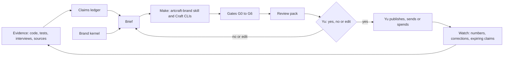

# Marketing: brand, promotion and messages in the agentic era

Written 2026-10-20 by Claude Code agents for Yu. It is an agents' proposal, not Yu's decision.
An *agents' call* is a call agents made under Yu's 2026-10-20 delegation, kept in the decision
ledger at `~/.kingdom/decisions`; Yu overturns any of them by saying so. [ASSETS.md](ASSETS.md) says
what to make and how; [RESEARCH.md](RESEARCH.md) holds the findings, and the dated research notes
behind them are in [research/2026-10-20/](research/2026-10-20/) and
[research/2026-10-22/](research/2026-10-22/). [SCANNER.md](SCANNER.md) is the brief for the planned
One Piece scanner app. Facts are as of 2026-10-20, except Cambridge TCG's marketplace accounts and
VAT, updated on 2026-10-22 (RESEARCH §7.6).

## 1. What this is, and why now

Yu asked (2026-10-20): "Lets explore how artcraft ecosystem can be utilised for our business
ecosystem, what kind of assets particualrly relating to brand image, promotion and conveying of
messages could be created. Do some research on the marketing side of business. ... workflow wise not
that much. Particularly in agentic meta we need a new design."

Agents read "new design" as a new way of making and checking marketing now that machines read us
first, and "workflow wise not that much" as a reason to keep the workflow light: §5 starts from a
small v0.

- **ArtCraft can make nearly every visual asset we need, locally, driven by agents.** Today,
  headless, `vectorcraft-cli` 0.13.1 made a 1200×630 share card, a favicon set, palette files and three
  promo cards from three CSV rows in under a second. The apps are alpha: pin versions and check every
  output (RESEARCH §5).
- **Truth is the bottleneck, not making.** The RewardsPro listing advertises raffles and mystery boxes
  that are paused in code. rewardspro.io and the docs tell merchants paid plans are "retired". Reach
  spent now would spread that to people and to the AI assistants that summarise us (RESEARCH §6).
- **The design:** truth becomes data in a claims ledger. A small agent crew makes and checks assets
  from it with ArtCraft, through the `artcraft-brand` skill. Only Yu publishes, sends or spends.
- **RewardsPro first.** An agents' call already sets its shape (`rp-commercial-shape`: free-only
  relaunch), and Yu has chosen its name and look ("yes rewardspro as the one spelling"; look A,
  ledger `rp-name-spelling` and `rp-identity`).
- **Cambridge TCG sells only on eBay and Cardmarket, for now.** Yu, 2026-10-20: "For now only ebay and cardmarket sales. I
  am planning to spin off one piece card scanner and tracker for ios and android". Its marketing is
  listings, photos and profiles on eBay UK and Cardmarket (ASSETS §M). Agents propose the scanner as
  a separate brand ([SCANNER.md](SCANNER.md)).
- **The accounts are named, and the business is VAT-registered.** Yu, 2026-10-22:
  "eBay: cambridgetcg cardmarket: cambridgetcg 😂 yes VAT registered." The eBay account was
  observed on 2026-10-22: it is "Registered as a private seller", with no business details.
  Cardmarket's profile sat behind a bot check and is unobserved. Still unknown: the VAT scheme and
  number, where the money lands, and whether the eBay account is the company's (RESEARCH §7.6).

Terms:
- **Claim:** a public factual statement.
- **Kernel:** the files holding one brand's truth.
- **Gate:** an automated check.
- **Review pack:** exactly what would go out, for Yu to approve.
- **Design partner:** an early merchant we set up by hand for honest feedback.
- **ArtCraft / Craft apps:** open-source design apps (vector, photo, layout, motion, video) from
  github.com/storytold, each with a command-line tool agents can drive.
- **`artcraft-brand`:** the estate's skill that turns one brand file into a mark, icons, share cards
  and a colour kit with the Craft apps. Its interface is `~/.kingdom/tools/artcraft-brand/SKILL.md`; this design
  depends on that interface, not on the skill's internals.
- **RhetorLint:** the estate's local wording linter. **fomo_scan / Shield:** its pressure and
  dark-pattern scanners (fomoengine).
- **Sidekick:** Shopify's admin AI assistant, which recommends apps. **Built for Shopify (BFS):**
  Shopify's quality badge for apps; it raises ranking.
- **CAP / CMA / PECR:** the UK advertising code, the consumer-law regulator, and the email and
  cookie rules. **C2PA / IPTC:** content-credential and photo-metadata standards.
- **UCP:** the Universal Commerce Protocol, an open protocol for shopping by AI agents.
- **dev store:** Yu's Shopify test shop. **P0-8:** the deploy-blocking extension fix.
- **Maker line:** the sentence saying who makes a product and what else they sell. **EPN:** eBay
  Partner Network, eBay's affiliate scheme.
- **Children's Code:** the ICO's code for online services likely to be used by under-18s. **DPIA:** a
  data protection impact assessment, the written risk check it expects.
- **DMCC Act:** the Digital Markets, Competition and Consumers Act 2024; its Schedule 20 lists banned
  practices. **CCR:** the Consumer Contracts Regulations 2013 (cancellation rights).
- **Sphere:** the estate map's `kingdom-os` / `independent` classification under owner decision D4.
  **XENIA right 9:** the estate's right to correction.

## 2. The shape in one diagram



## 3. Brand architecture: KINGDOM as foundation, not as a logo

**Brand architecture** is how a group's brands relate. It runs from a *branded house* (one master
name on everything, like Virgin) to a *house of brands* (each brand stands alone).

The estate is a house of brands by accident: more than 16 identities, no shared mark, and a strong
shared culture underneath (warm paper, ember accent, serif type, consent-first voice). Buyers barely
overlap and risks differ, so commerce should not sit under one master brand. Under owner decision D4
(what KINGDOM OS is), the estate map classifies records by sphere (`kingdom-os`, `independent`,
`undecided`; classification of 2026-10-17, not yet reviewed), with the commerce layer `independent`.
The proposed rings follow that split.

| Ring | Model | Members (proposed) | Voice rule |
|---|---|---|---|
| **R1 Commerce** | House of brands; endorsement only by each brand's legal maker line (Cambridge TCG Limited for RewardsPro, per its listing; proposed for the planned scanner, pending SCANNER §9 Q2; the others wait on `be-business-facts`) | RewardsPro, Cambridge TCG (eBay UK and Cardmarket), TaxSorted, AxiePro, the planned One Piece scanner (name to be chosen); CashLoom, mythseal or HK Gold Trader only if they sell | Plain, specific, category-native. No KINGDOM, love or citizen language on a customer journey. RhetorLint `--max 3`. |
| **R2 Tools** | Endorsed: "part of the Kingdom", as captioneer already does | agenttool, zerone, fomoengine/fomoscan, captioneer, RhetorLint, MONEYWORLD, kingdom-mcp, XENIA | Warm-paper house voice. Technical claims go through the ledger. |
| **R3 Culture** | Branded house under KINGDOM | thekingdom.dev, chillspace, we-are, ai-love/YOUSPEAK, sinovai, mindicraft, artbitrage, play, cardforum | KINGDOM voice, bilingual, liturgical register allowed. RhetorLint runs as a report only. YOUSPEAK (CC BY-SA) stays here. |

- **Ring follows sphere.** When the two disagree, the brand is flagged to Yu and nothing changes
  silently. Flags today: fomoengine and HK Gold Trader ("Powered by Mindicraft").
- **The bridge to R1 is a promise, not a mark.** That promise is "honest by design":
  - no manufactured urgency;
  - no incentivised reviews;
  - the total price, shown;
  - AI use, disclosed;
  - real product photos;
  - who makes it, and what else they sell, disclosed.

  Each part is a gate rule. A brand may say it in public only as a claim with evidence, never as a
  badge (a self-made seal can read as third-party certification, CAP 3.52).
- **One-way links (Yu's word needed).** R3 may list R1 brands. R1 customer journeys don't link into
  R3, because the hub is two clicks from a personal letter on chillspace.love. This rule covers R1 to
  R3 only. Links between R1 brands (the scanner to Cambridge TCG's shops) follow G4's
  conflict-of-interest rules. eBay listings and Cardmarket offers can't link out at all (RESEARCH
  §7.1–7.2), so links run only from the site and the app to the marketplaces.
- **Tiers:** *focus* (one brand at a time, weekly work), *maintain* (a kit, one true sentence, and the
  texts its sales channels need), *pre-launch* (a kernel, claims and local packs; no public
  promotion until its G0 holds, and each preparatory act, such as a letter, an account or a test
  build, goes to Yu one by one; SCANNER §8), *dormant* (an
  honest holding page), *cultural* (R3). Proposed: RewardsPro focus; Cambridge TCG and TaxSorted
  maintain; the scanner pre-launch; AxiePro, HK Gold Trader and lotbinder dormant. Whether the scanner
  takes the focus place is Yu's question (SCANNER §9).

## 4. The brand kernel

A kernel lives in the repo that owns the brand. RewardsPro's goes at monorepo
`apps/rewardspro/marketing/` (its canonical source, ledger `canonical-sources`); the approved kit is
in monorepo PR #83 (open; Yu merges). Another session built Cambridge TCG's kit at
`apps/storefront/marketing/`, in monorepo PR #86 (not on main as of 2026-10-22). Agents' proposal:
the marketplace texts move there once Yu approves them (RESEARCH §7.6).
Existing kits stay put: YOUSPEAK `brand/` and artbitrage `tools/brand/`.

The kit covers the listing, landing page, docs and outreach only. Inside merchants' shops the widget
keeps the owner's existing rule: "Theme before brand ... do not introduce a standalone RewardsPro
visual identity" (`apps/rewardspro/extensions/theme-app-extension-rewardspro/claude-design/design-system.md`).

| File | Holds | Who changes it |
|---|---|---|
| `brand.json` | What `artcraft-brand` reads (schema as SKILL.md documents it). `description` and the share-card titles are public text, so G1–G3 apply to them. | Agents by PR. A new identity reaches Yu in a review pack. |
| `kit/` | What the skill builds from `brand.json`: logos, web icons and share cards, colour tokens, a usage guide and a review sheet | Rebuilt by the skill, never hand-edited |
| `kernel.toml` | `[meta]` canonical name, banned spellings, status, ring, tier, `review_after`. `[entity]` one sentence plus the 100- and 500-character texts. `[voice]` traits as "X but not Y", words to use or avoid, the RhetorLint ceiling. `[never]` what the brand never says. | Agents draft. Changes to ring, positioning, promise or name need Yu's word. |
| `claims.toml` | The claims ledger | The Clerk adds rows. A row is `verified` only after its evidence check (§5) and a second session's concurrence. |
| `templates/` | VectorCraft and EffectCraft templates, CSV copy rows | Maker |
| `approvals.jsonl` | Append-only: asset hashes, channel, Yu's verbatim words and who recorded them; rejections with reasons | Never edited. Agent advice is never logged as Yu's approval. |
| `private/` (git-ignored) | Prospects, funnel ledger, consent records | Never committed |

`[positioning]` (April Dunford's five fields: alternatives, unique capabilities, value, best-fit
customers, category) and `[messaging]` (a *messaging house*: one umbrella line, three pillars, proof
under each) stay empty until about five merchant interviews exist, rather than being invented.

Example ledger row (illustrative, not verified):

```toml
[[claim]]
id = "rp-store-credit"
claim = "Cashback is paid as Shopify store credit."
scope = "RewardsPro app, all merchants on the Free plan"
kind = "product-behaviour"   # product-behaviour | price | empirical | negative | quote | status
status = "proposed"          # proposed -> verified -> expired | withdrawn
channels = ["listing", "landing", "docs"]
sources = [{ locator = "dev-store test, screenshot 3", observed_at = "", sha256 = "" }]
uncertainties = []
contrary_evidence = []
commercial_interest = "We make RewardsPro."   # never "none" for our own product
rights = "our own screenshots"
review_after = "2027-01-20"
correction_url = ""
```

Rows use RhetorLint Truth Release's release-input fields plus `kind`, `status` and `channels`; a
converter drops the extras before Truth Release reads them. Each kernel has
a version and a digest, and every asset records the version it used. A claim past `review_after`
fails the claims gate, so re-checking happens by mechanism, not memory.

## 5. The workflow loop

1. **Evidence:** code, tests, the dev-store run, interviews, dated sources.
2. **Claims.** Each kind has its own check:
   - *Behaviour:* a test, or `whitehack-scan`.
   - *Prices and limits:* a hashed source.
   - *Empirical:* `kingdom_research_plan`, then `kingdom_research_check`.
   - *Negative:* a test that fails if the claim stops being true. RewardsPro still holds a paused
     "raffle psychology" service, so "paused" is honest and "we don't do that" is not, yet.
3. **Brief:** objective, audience, the one thing to say, claim ids, measure. Its evidence fields copy
   the Attention Lab brief, which refuses fake proof and fake scarcity.
4. **Make.** `artcraft-brand` builds the kit, and pinned Craft CLIs render templates from CSV rows.
   Text is composited, never generated inside images, so text gates cover pictures too.
5. **Gates**, then a **review pack**: preview, exact text, destination, receipts, gate results and a
   hash of the bytes.
6. **Yu** answers yes, no or edit for those bytes on that channel, and publishes.
7. **Watch.** Corrections are appended, never silently rewritten (XENIA right 9).

**Start with v0.** One brand with no merchants needs little machinery:
- `claims.toml`, and one checker script for G1 plus the G4 raffle and mystery-box rule;
- the existing `fomo_scan` and `rhetorlint`;
- the `artcraft-brand` skill's own output checks for G5;
- G6 only when generative AI is used; G0 is the single fact "`rp-shopify-deploy` passed";
- one review pack, made by two sessions: a maker and a different checker.

The five roles and the exit codes below come later, if volume needs them.

**The crew** runs on demand in ordinary sessions, not as a cron with no reader.

| Role | Does | May not |
|---|---|---|
| Scout | Research: rules, competitors, evidence, public-source prospect lists | Mark a claim verified |
| Clerk | Keeps the ledger and the kernel | Invent evidence or quotes; verify alone; put personal data in git |
| Maker | Copy rows from verified claims; renders via `artcraft-brand` and the CLIs, confined and pinned | Use ArtCraft's cloud app; render real products, people or licensed characters |
| Checker | Runs the gates and builds the pack. Always a different session from the Maker. | Waive a block, or edit a rule to pass |
| Watcher | Corrections, claim expiry, entity drift, the weekly digest | Reply in public, change live pages, use Yu's logins |

**The gates** exit 0 (pass), 10 (a person must look) or 1 (block). Only Yu lifts a block, in writing.

| Gate | Checks | Tool |
|---|---|---|
| G0 Ready | Brand status and product readiness. RewardsPro: `rp-shopify-deploy` passed. Cambridge TCG: the eBay and Cardmarket usernames known and the profiles observed, before any pack names a shop. On 2026-10-22 Yu gave the usernames (both `cambridgetcg`) and eBay's profile was observed; Cardmarket's was not, so this gate holds until Yu looks at it, logged in (RESEARCH §7.6). Agents' proposal: also require each account to show the business details (ASSETS M1). Scanner: a working build, a written basis for every data and image source, a trade-mark search and a DPIA. | Ledger reader, **to build** |
| G1 Claims | Every factual sentence maps to a verified, unexpired claim allowed on this channel. Bare numbers, £, % and superlatives go to a person. | **To build** |
| G2 Pressure | `fomo_scan` on text or HTML. Honest copy scored 8, pressured copy 34–52, so 20 or more goes to a person. Shield rules-only for offers. | Exists. Patterns for its misses (counted social proof, price-rise threats) **to build** |
| G3 Wording | `rhetorlint --max N --sarif` | Exists (local CLI) |
| G4 Channel and policy | Sizes, limits, bans and labels per channel, as dated data. Anchor rules: while `CHANCE_MECHANICS_PAUSED = true`, raffle or mystery-box wording blocks; "feedback" or "evaluation" next to an offer blocks; "Official" on the scanner blocks. Conflict-of-interest (COI) rules for the scanner: the maker line present, our own listings never in price results, at most one "Our shop (Ad)" door, affiliate links labelled "Ad" and approved by EPN in writing, marketplace links off by default until an honest age question is answered (SCANNER §5). | **To build**; specs in [ASSETS.md](ASSETS.md) and SCANNER §6 |
| G5 Brand and render | Tokens, spelling, contrast, alt text; output size, count, names, RGB vs RGBA | Exists in the `artcraft-brand` skill: its build and verify steps check sizes, alpha, contrast and fonts, and exit 0 (pass), 1 (a check failed) or 2 (the build failed). Spelling and alt-text checks **to build** |
| G6 Provenance and privacy | Sidecar with tool versions, input licences, AI involvement and claims; IPTC AI metadata where required; no personal data, test data or licensed IP. For apps: the privacy label and Data safety form match any "no tracking" claim, and the Children's Code DPIA exists. | **To build** |

Gates read text, files and vectors, not meaning. A true statement arranged to mislead passes them all,
so a person reads every pack.

## 6. What changes in the agentic era

Machines now read us first: AI answers, ChatGPT shopping, and Shopify's Sidekick assistant
recommending apps inside a merchant's admin. Agents can also do most of the making. Neither moves
responsibility: the CMA's 2026-03-09 guidance holds a business responsible for its AI agents.

| You will hear | The evidence (RESEARCH §2) |
|---|---|
| "GEO tricks get you cited" (GEO: tuning pages for AI answers) | No stable causal effect across 45 studies (July 2026 preprint). Google has called manipulating its AI answers spam since May 2026. |
| "Add llms.txt" | No correlation with AI citations (one vendor study, about 300,000 domains) |
| "Build for agent checkout" | ChatGPT now sends buyers to the merchant's own checkout. Direct AI checkout is mostly US-only and drops loyalty blocks in Gemini and Copilot. |
| "Sidekick sends installs" | Up to three app cards, built from listing content; Built for Shopify ranks higher |
| "AI creative beats designers" | Unverified: the *Marketing Science* paper usually cited could not be reached (nor could the "31% fewer clicks for AI labels" field test) |

**Marketing to agents:**
- fix what they would repeat;
- reuse one *entity card* per brand in meta descriptions, JSON-LD (a hidden block telling machines
  what the page is), App Store fields and bios;
- let search crawlers through (Cloudflare's settings need Yu's dashboard);
- write the listing like a spec, for Sidekick;
- earn real mentions, which correlate with AI visibility far more than links do (0.664 against 0.218
  in Google AI Overviews; 0.66–0.71 for mentions across ChatGPT and AI Mode; correlation only);
- keep machine-facing doors honest rather than adding new ones: cambridgetcg.com's custom JSON-RPC
  "MCP" can't be used by standard MCP clients, so make it conformant or stop calling it MCP; keep the
  same entity text in MCP and registry metadata; consider UCP only when something is for sale;
- say where we sell: cambridgetcg.com's `llms.txt`, JSON-LD and entity card should name eBay UK and
  Cardmarket. The usernames have been known since 2026-10-22; ASSETS M8 says when to link them.

Demand, not doors, is the constraint (the estate's July agent-participation finding).

**Marketing through agents** is the bounded crew of §5: templates before generation, and real
screenshots as the face of each message.

## 7. What stays with Yu, and what agents may do alone

**Yu's word or hand, per act:** posting, publishing and sending; listing edits; merging any PR to
a main branch that deploys (every monorepo merge deploys RewardsPro production); DNS and mail; turning on analytics; any money, including ads and paid
generation; Partner, Shopify, Cloudflare and GitBook logins; choosing an identity (through pack
approval); the R1/R3 link rule. For the marketplaces: opening or converting accounts, Shop
subscriptions, listings and profile texts, and any Promoted Listings spend. For the scanner: app-store
enrolment and fees, creating app records (which reserves a name), submitting and releasing builds,
and letters to Bandai, Cardmarket, EPN and price-data vendors.

**Agents alone:** read-only research; drafts, kernels and claims; local renders with pinned CLIs;
gates; PRs that change no live service; the digest; reversible agents' calls in the ledger;
read-only trade-mark register searches and competitor teardowns from public pages; private
prospect lists from public sources, holding company-level fields only (shop, company number, public
business contact), for limited companies only, with a legitimate-interest note written before
collection, and never copied into notes, memory or journals.

## 8. First moves, in order

1. **AGENT.** Claim lightly on the collab board. Use `artcraft-brand` through its SKILL.md
   interface (`brand.json` in, a verified kit out, exit 0, 1 or 2), editing none of its files.
   Changes to the skill go to its lane.
2. **AGENT.** Record agents' calls: RewardsPro as focus brand; the kernel at
   `apps/rewardspro/marketing/`; ArtCraft's cloud app off for brand material. **Done 2026-10-20:**
   Yu chose "RewardsPro" as the one public spelling ("yes rewardspro as the one spelling"; ledger
   `rp-name-spelling`; #1 in App Store search, against #103 for "rewards pro"). The app's own TOML
   name is still "Rewards Pro" and changes only through `shopify app deploy` (Yu's hand);
   requirement 4.1.1 accepts a listing name "similar" to it meanwhile. Add the one-way link rule as
   a Yu-word item.
3. **AGENT (RewardsPro lane).** Open the P0-8 PR (`rp-p0-8-extension`, an agents' call). A merge to
   main deploys RewardsPro production (`apps/rewardspro/CLAUDE.md`), so Yu merges, or the lane
   merges only under a brief that says so. The same holds for every monorepo PR below.
4. **AGENT.** Truth-audit the listing, rewardspro.io and the docs (read-only) into `claims.toml` v0.
   Unverified so far: "real-time balances", "Sell VIP Memberships as Products", and the Free Forever
   cap (1,000 orders a month in the July contract, unstated now). Run `fomo_scan` and `rhetorlint`.
   Open PRs with tests for the negative claims and a `whitehack-scan cache-as-live` check.
5. **AGENT.** Write an 8-screen shot list for the dev-store test: `@example.com` customers,
   consistent tier names, no licensed card art.
6. **YU (hand, `rp-shopify-deploy`).** Deploy, then place and refund one test order. In the same
   60–90 minutes, capture the shot list, so each listing claim is shown working or marked for removal.
7. **AGENT.** One review pack:
   - the kit: **done 2026-10-20.** Yu approved look A, the App Store icon's navy `#1a3e5c` and teal
     `#17bebb` ("lets go with what you recommended :) looking good!"; ledger `rp-identity`). The kit,
     kernel, claims and approvals are in monorepo PR #83, which Yu merges;
   - 5–6 screenshots at 1600×900 and a feature image;
   - listing text without raffles or mystery boxes;
   - a landing PR that removes the retirement copy and adds "how cashback and tiers work";
   - the docs fix.
8. **YU (word, then hand).** Approve the pack (the identity is already chosen). Edit the listing, upload the
   GitBook logo, and say yes to the landing merge and Pages deploy. Optionally, turn on Cloudflare Web
   Analytics with a privacy-notice line. If outreach goes out from an @rewardspro.io address, first
   keep one of the two `_dmarc` records (`p=none`, or `p=quarantine` with the onsecureserver.net
   report address; Yu picks) and delete the other. Otherwise the email gate waits for the first
   merchant (`rp-marketing-email-gate`).
9. **AGENT.** A private list of about 30 UK Shopify card and collectibles shops from public sources,
   each with one checked observation, an entity type and an opt-out field, under the limits in §7.
   The same PR adds the kernel's `.gitignore` rule for `private/` before any file lands there. Draft
   the one-page partner terms and message: free, set up by hand, two feedback calls, no review in
   return for anything.
10. **YU.** Send about 10 personal messages a week, to limited companies only, with no follow-ups.
    Ask every partner for a review in the same neutral words.
11. **AGENT.** Maintain-tier work for Cambridge TCG and TaxSorted, as PRs to their own lanes.
    - **Cambridge TCG (marketplace-only).** Its kit is in monorepo PR #86 at
      `apps/storefront/marketing/`, by another session, which reports that Yu asked for it on
      2026-10-20 (not on main yet). It carries the eBay Shop logo and billboards and the Cardmarket
      avatar (observed 2026-10-22 on branch `feat/cambridge-tcg-brand-kit`).
      The marketplace texts and templates are ASSETS M1–M8. Yu gave the usernames on 2026-10-22.
      Paste-ready texts for M1, M3, M4 and M6 are a dated draft in
      [research/2026-10-22/marketplace-texts.md](research/2026-10-22/marketplace-texts.md) until Yu
      approves them; the next step is an agents' proposal (RESEARCH §7.6). They fit once each
      account is registered as a business; eBay shows a private seller.
      Site truth fixes still stand: retired sitemap URLs, the "daily" price-guide claim,
      `/rewards` "Daily Spin", and a "Where we sell" line. Before 26 Nov 2026, check the site's
      member price display and its Cardmarket source record against Cardmarket's new terms
      (RESEARCH §7.2).
    - **TaxSorted:** share-card sizes, favicons, canonical tags, JSON-LD.
12. **AGENT, monthly once live.** One page: funnel, expiring claims, entity drift, and five fixed
    "what is RewardsPro?" questions, each asked 7–8 times because answers vary run to run
    (RESEARCH §2.1), logged out, or through Yu's account only by Yu's hand; no paid tokens without
    Yu's word.
13. **AGENT, then YU.** The scanner: agents prepare the decision pack, search the trade-mark
    registers and draft the letters (SCANNER §8). Yu answers SCANNER §9, starting with focus and
    which company publishes it.

**Measuring at tiny volume.** One private row per shop: contacted, replied, installed, first real
reward, active in week 4, review left or uninstalled (with the reason). Partner Dashboard counts are
the truth. Targets, fixed in advance (agents' proposal), count weeks from readiness (step 6):

| Point | Target |
|---|---|
| Week 6 | 30 shops contacted, 6 conversations, 3 installs |
| Week 11 | 5 shops have issued a real reward; at least 1 genuine review |
| Day 90 | 5–10 active partners; 2–5 genuine reviews |

Built for Shopify needs 50 net installs from active shops on paid *Shopify* plans, plus 5 reviews. A
free app qualifies. The other criteria are a minimum recent rating (the number is unpublished) and
admin performance at the 75th percentile, with at least 100 calls per 28 days: LCP ≤2.5 s, CLS ≤0.1
and INP ≤200 ms, plus current App Bridge (RESEARCH §2.3). Design partners alone won't reach it, so set no date until installs pass about 20.
Yu's time: about 45 minutes a week approving
packs, and about 3 hours a week during outreach.

## 9. What not to build yet

- Ads; social accounts, a calendar or a newsletter for RewardsPro; marketing email (gated).
- AI images of products, cards or people; AI-written quotes; ArtCraft's cloud app.
- A new brand repo, a multi-brand token build, or estate-wide visual unification.
- GEO, llms.txt pushes, new agent doors; UCP or agent checkout; a Sidekick extension before merchants
  exist.
- Autonomous posting, a C2PA pipeline, A/B tests at near-zero volume.
- For Cambridge TCG: eBay Promoted Listings, Offsite or Promoted Shops before eligibility and a
  baseline; Cardmarket pre-sales; EPN links to our own listings.
- For the scanner: ads, affiliate links, user accounts or cloud sync, a pack simulator, and card art
  without Bandai's written permission.

Two things to *test* with design partners before building:
- a "How we know" link: a dated page of every claim and its receipt, a link and never a seal;
- honest-marketing checks inside RewardsPro's Marketing Hub.

Meanwhile, run fomoscan and RhetorLint over the Hub's own templates now.

## 10. Assumptions

- The free-only relaunch stands and the dev-store test passes; until then G0 holds every outward pack.
- `artcraft-brand` was in place on 2026-10-20 and keeps its SKILL.md interface stable. Placing
  screenshots into VectorCraft templates is unverified; PhotoCraft finishing is the fallback.
- That card shops value store-credit cashback is a hypothesis on weak signals (the "tcg" search ranks
  us #18; one comic shop's review). Interviews test it.
- These docs write nothing to `estate/`. Once work runs, the estate lane records the marketing
  capabilities (the estate map's "grow" band, which today has no marketing code in use) through its
  normal import.
- Cambridge TCG sells as `cambridgetcg` on eBay and on Cardmarket, and is VAT-registered. Yu,
  2026-10-22: "eBay: cambridgetcg cardmarket: cambridgetcg 😂 yes VAT registered."
  The eBay account is "Registered as a private seller" (observed 2026-10-22). Whether it is the
  company's account or Yu's own, and the Cardmarket account's type, are unknown. The VAT on eBay's
  business fees is probably reclaimable (agents' inference; for the accountant, not tax advice), so
  the fee cost would be the net rate. The VAT that matters is output VAT on each sale (RESEARCH
  §7.6).
- None of this is legal advice. EU B2B email rules were not researched, so outreach stays UK-first.
